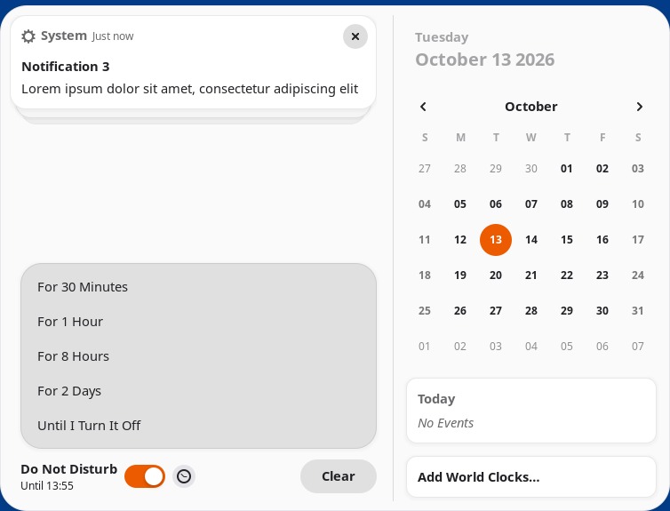

# Do Not Disturb in Calendar

A GNOME Shell extension that puts the Do Not Disturb switch back at the bottom
of the date menu and shows its icon next to the clock, as in earlier GNOME
versions. The toggle is removed from the quick settings.

Do Not Disturb can also be turned on for a while, like muting a chat: for
30 minutes, an hour, 8 hours or 2 days. It then turns itself off, even if the
screen is locked.



[Русская версия](README.ru.md)

## Features

- The **Do Not Disturb** switch at the bottom of the date menu, next to
  **Clear**.
- The Do Not Disturb icon next to the clock while it is on.
- The clock button next to the switch turns Do Not Disturb on for a while.
  Until then, the date menu tells when it turns off, such as "Until 18:30".
  Turning Do Not Disturb off by hand cancels the timer.
- No Do Not Disturb toggle and icon in the quick settings.
- Works with the keyboard.
- Follows the `show-banners` setting of GNOME (`org.gnome.desktop.notifications`),
  so Do Not Disturb can still be changed in other ways, such as in Settings.
- In English and Russian.

## Requirements

GNOME Shell 50. Tested on Ubuntu 26.04 LTS, in the Ubuntu and GNOME sessions,
on Wayland.

## Installation

### From extensions.gnome.org

Search for *Do Not Disturb in Calendar* on
[extensions.gnome.org](https://extensions.gnome.org/) or in Extension Manager,
and switch it on.

### From the source code

```sh
git clone https://github.com/Mist3s/dnd-in-calendar.git
cd dnd-in-calendar
./install.sh
```

The script packs the extension and installs it for the current user, into
`~/.local/share/gnome-shell/extensions/`. It needs `zip`, `glib-compile-schemas`
and `gnome-extensions`. To compile the translations, it uses `msgfmt` if
gettext is installed, and Python otherwise.

On Wayland, GNOME Shell finds a new extension only after you log out and back
in. Then switch it on in Extensions, or with:

```sh
gnome-extensions enable dnd-in-calendar@mist3s.github.io
```

A packed extension, a `.shell-extension.zip` file, is installed with
`gnome-extensions install --force dnd-in-calendar@mist3s.github.io.shell-extension.zip`.

## Switching off and removing

```sh
gnome-extensions disable dnd-in-calendar@mist3s.github.io
```

brings the stock date menu and quick settings back at once, without logging
out. Do Not Disturb stays as it was, and while the extension is off, no timer
turns it off. To remove the extension:

```sh
./install.sh uninstall
```

or `gnome-extensions uninstall dnd-in-calendar@mist3s.github.io`.

## Settings

The durations in the menu are a setting, in minutes:

```sh
gsettings --schemadir ~/.local/share/gnome-shell/extensions/dnd-in-calendar@mist3s.github.io/schemas \
    set org.gnome.shell.extensions.dnd-in-calendar durations '[15, 60, 240, 1440]'
```

`reset` instead of `set … '[…]'` brings back the default ones.

## How it works

- Do Not Disturb is on while `show-banners` of `org.gnome.desktop.notifications`
  is off. The switch and the icon next to the clock follow this setting.
- When Do Not Disturb is turned on for a while, the extension saves the time to
  turn it off in its `dnd-until` setting and sets a timer for it. The timer is
  set again after resuming from suspend and on logging in. If the time has
  passed in the meantime, Do Not Disturb is turned off at once.
- The extension keeps running while the screen is locked, only to turn Do Not
  Disturb off on time. It adds nothing to the lock screen.
- It changes internal parts of GNOME Shell: the date menu and the quick
  settings. These change between GNOME versions, so each new version needs
  checking, and the extension is only marked as compatible with the versions
  it was tested on.

## Checking the log

Errors of the extension name its UUID in the log of GNOME Shell:

```sh
journalctl -b -o cat /usr/bin/gnome-shell | grep -A10 dnd-in-calendar
```

On Ubuntu, the log may have errors of Ubuntu Dock after Do Not Disturb is
turned off, such as `remoteModel is undefined` and `this._area is undefined`.
They come from Ubuntu Dock (`ubuntu-dock@ubuntu.com`) and happen without this
extension too.

## Development

- `src/`: the extension, as it is packed
- `po/`: the translations
- `install.sh`: packs and installs the extension
- `tests/`: tests in headless GNOME Shells

### Tests

```sh
tests/run-headless.sh
```

starts GNOME Shells without a display, isolated from your session: each has its
own D-Bus buses, home directory and settings. The tests click and type through
the date menu, check the timer, the lock screen, switching the extension on and
off, at startup and in a running GNOME Shell, in the GNOME and Ubuntu sessions,
in English and Russian. A test fails on warnings of the extension in the log of
GNOME Shell. The logs and screenshots go into `build/tests/`.

### Packing for extensions.gnome.org

```sh
./install.sh pack
```

creates `build/dnd-in-calendar@mist3s.github.io.shell-extension.zip`, to upload
at [extensions.gnome.org/upload](https://extensions.gnome.org/upload/).

### Translations

The template is `po/dnd-in-calendar.pot`. To add a language, copy it to
`po/LANGUAGE.po`, such as `po/de.po`, fill in the header and translate it.
`install.sh` compiles all the `po/*.po` files. "Do Not Disturb" itself comes
from the translations of GNOME Shell.

After changing the strings in the code, update the template and the
translations with gettext:

```sh
xgettext --from-code=UTF-8 --language=JavaScript --add-comments=Translators: \
    --keyword --keyword=_ --keyword=ngettext:1,2 \
    --package-name=dnd-in-calendar \
    --msgid-bugs-address=https://github.com/Mist3s/dnd-in-calendar/issues \
    --output=po/dnd-in-calendar.pot src/extension.js
for po in po/*.po; do msgmerge --update --backup=none "$po" po/dnd-in-calendar.pot; done
```

## Code of conduct

This project follows the [GNOME Code of Conduct](https://conduct.gnome.org/).

## License

GPL-2.0-or-later, see [LICENSE](LICENSE).
