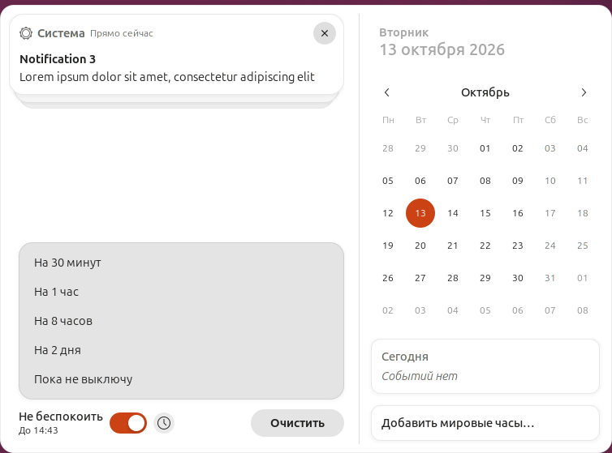
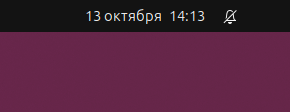

<div align="center">

# Do Not Disturb in Calendar

**Переключатель «Не беспокоить» снова в меню с датой, а теперь и с таймером.**

Расширение GNOME Shell, которое возвращает «Не беспокоить» вниз меню с датой и
календарём, как в прежних версиях GNOME, и позволяет отключить уведомления на
время, как в чате.

[](https://extensions.gnome.org/extension/11247/do-not-disturb-in-calendar/)
[](#требования)
[](LICENSE)

<a href="https://extensions.gnome.org/extension/11247/do-not-disturb-in-calendar/">
  
</a>

[English](README.md) · **Русский**

<picture>
  <source media="(prefers-color-scheme: dark)" srcset="docs/screenshot-ru-dark.png">
  
</picture>

</div>

## Возможности

- 🎚️ **Снова в меню с датой.** Переключатель «Не беспокоить» внизу меню с
  датой, рядом с кнопкой **Очистить**.
- ⏱️ **На время.** Уведомления можно отключить на 30 минут, час, 8 часов,
  2 дня или пока не включите их снова. В меню написано, когда режим
  закончится, например «До 18:30», и выключается он вовремя, даже если экран
  заблокирован.
- 🔕 **Значок рядом с часами**, пока режим включён.
- 🧹 **Чистые быстрые настройки.** Переключатель и значок «Не беспокоить»
  оттуда убраны.
- ⌨️ **Всем можно управлять с клавиатуры.**
- 🔄 **Заодно с GNOME.** Режим хранится в настройке GNOME `show-banners`,
  поэтому его по-прежнему можно менять и другими способами, например в
  «Параметрах».
- 🌍 **На русском и английском.**

<p align="center">
  <picture>
    <source media="(prefers-color-scheme: dark)" srcset="docs/panel-ru-dark.png">
    
  </picture>
</p>

## Как пользоваться

1. Нажмите на часы на верхней панели, чтобы открыть меню с датой.
2. Включите **Не беспокоить**, чтобы отключить уведомления, пока не выключите
   режим сами.
3. Или нажмите кнопку с часами рядом с переключателем и выберите, на сколько.

Если выключить режим вручную, таймер отменяется.

## Установка

### С GNOME Extensions (рекомендуется)

Включите его на
[странице на extensions.gnome.org](https://extensions.gnome.org/extension/11247/do-not-disturb-in-calendar/).

> [!TIP]
> Для сайта в браузере нужно дополнение GNOME Shell integration. Без него
> найдите *Do Not Disturb in Calendar* в Extension Manager и установите оттуда.

### Из исходного кода

```sh
git clone https://github.com/Mist3s/dnd-in-calendar.git
cd dnd-in-calendar
./install.sh
```

Скрипт собирает расширение и устанавливает его для текущего пользователя в
`~/.local/share/gnome-shell/extensions/`. Ему нужны `zip`,
`glib-compile-schemas` и `gnome-extensions`. Переводы он компилирует с помощью
`msgfmt`, если установлен gettext, а иначе с помощью Python.

> [!NOTE]
> На Wayland GNOME Shell видит новое расширение только после того, как вы
> выйдете из сеанса и войдёте снова. Затем включите его в «Расширениях» или
> командой `gnome-extensions enable dnd-in-calendar@mist3s.github.io`.

Собранное расширение, файл `.shell-extension.zip`, например из
[релиза](https://github.com/Mist3s/dnd-in-calendar/releases), устанавливается командой
`gnome-extensions install --force dnd-in-calendar@mist3s.github.io.shell-extension.zip`.

### Требования

GNOME Shell 50. Проверено на Ubuntu 26.04 LTS, в сеансах Ubuntu и GNOME,
на Wayland.

## Настройки

Длительности в меню задаются настройкой, в минутах. По умолчанию это
`[30, 60, 480, 2880]`:

```sh
gsettings --schemadir ~/.local/share/gnome-shell/extensions/dnd-in-calendar@mist3s.github.io/schemas \
    set org.gnome.shell.extensions.dnd-in-calendar durations '[15, 60, 240, 1440]'
```

Если вместо `set … '[…]'` написать `reset`, вернутся длительности по умолчанию.

## Выключение и удаление

```sh
gnome-extensions disable dnd-in-calendar@mist3s.github.io
```

сразу возвращает обычные меню с датой и быстрые настройки, без выхода из
сеанса. «Не беспокоить» остаётся как было, и пока расширение выключено, таймер
режим не выключит. Удалить расширение можно командой `./install.sh uninstall`
или `gnome-extensions uninstall dnd-in-calendar@mist3s.github.io`.

<details>
<summary><b>Как это работает</b></summary>

- «Не беспокоить» включён, пока выключена настройка `show-banners` в
  `org.gnome.desktop.notifications`. Переключатель и значок рядом с часами
  следуют за ней.
- Когда режим включают на время, расширение сохраняет время выключения в своей
  настройке `dnd-until` и ставит на него таймер. После выхода из ждущего режима
  и при входе в сеанс таймер ставится заново. Если время за это время уже
  прошло, режим выключается сразу.
- Расширение продолжает работать, пока экран заблокирован, только чтобы
  выключить режим вовремя. На экран блокировки оно ничего не добавляет.
- Оно меняет внутренние части GNOME Shell: меню с датой и быстрые настройки.
  Они меняются от версии к версии GNOME, поэтому каждую новую версию нужно
  проверять, и расширение помечено совместимым только с теми версиями, на
  которых оно проверено.

</details>

<details>
<summary><b>Если что-то не так</b></summary>

Ошибки расширения в журнале GNOME Shell содержат его UUID:

```sh
journalctl -b -o cat /usr/bin/gnome-shell | grep -A10 dnd-in-calendar
```

В Ubuntu после выключения «Не беспокоить» в журнале бывают ошибки Ubuntu Dock,
например `remoteModel is undefined` и `this._area is undefined`. Это ошибки
самого Ubuntu Dock (`ubuntu-dock@ubuntu.com`), они бывают и без этого
расширения.

Нашли ошибку? [Создайте issue](https://github.com/Mist3s/dnd-in-calendar/issues).

</details>

## Разработка

Как помочь проекту, описано в [CONTRIBUTING.md](CONTRIBUTING.md), а что менялось
от версии к версии — в [CHANGELOG.md](CHANGELOG.md).

```
src/          само расширение в том виде, в каком оно упаковывается
po/           переводы
tests/        тесты в GNOME Shell без экрана
install.sh    сборка и установка
```

### Тесты

```sh
tests/run-headless.sh
```

запускает GNOME Shell без экрана, отдельно от вашего сеанса: у каждого теста
свои шины D-Bus, домашний каталог и настройки. Тесты щёлкают мышью и нажимают
клавиши в меню с датой, проверяют таймер, экран блокировки, включение и
выключение расширения — при запуске GNOME Shell и в уже работающем, в сеансах
GNOME и Ubuntu, на английском и русском. Тест не проходит, если в журнале
GNOME Shell есть предупреждения расширения. Журналы и снимки экрана
сохраняются в `build/tests/`.

### Сборка для extensions.gnome.org

```sh
./install.sh pack
```

создаёт `build/dnd-in-calendar@mist3s.github.io.shell-extension.zip` для
загрузки на [extensions.gnome.org/upload](https://extensions.gnome.org/upload/).

### Переводы

Новые переводы приветствуются. Шаблон — `po/dnd-in-calendar.pot`. Чтобы
добавить язык, скопируйте его в `po/ЯЗЫК.po`, например `po/de.po`, заполните
заголовок и переведите строки. `install.sh` компилирует все файлы `po/*.po`.
Сама надпись «Не беспокоить» берётся из переводов GNOME Shell.

<details>
<summary>Обновление шаблона после изменения строк в коде</summary>

```sh
xgettext --from-code=UTF-8 --language=JavaScript --add-comments=Translators: \
    --keyword --keyword=_ --keyword=ngettext:1,2 \
    --package-name=dnd-in-calendar \
    --msgid-bugs-address=https://github.com/Mist3s/dnd-in-calendar/issues \
    --output=po/dnd-in-calendar.pot src/extension.js
for po in po/*.po; do msgmerge --update --backup=none "$po" po/dnd-in-calendar.pot; done
```

</details>

## Правила поведения

Проект следует [Кодексу поведения GNOME](https://conduct.gnome.org/).

## Лицензия

[GPL-2.0-or-later](LICENSE)
